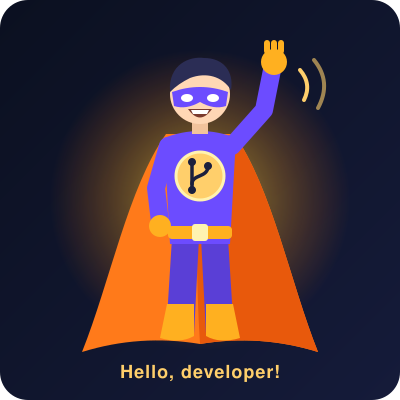
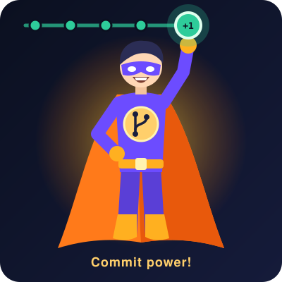
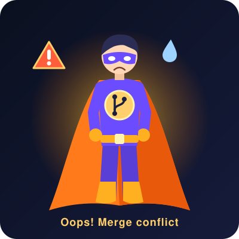

# Git Power

[](https://opensource.org/licenses/MIT)

<p align="center">
  
</p>

Git Power is a tool designed to measure your software development activity and impact based on your Git commit history. By analyzing your repository data, it calculates an activity score that reflects your coding output, consistency, and overall development power.

## Features

* **Commit Analysis:** Tracks your commit frequency, consistency, and patterns over time.
* **Activity Scoring:** Calculates a unique "power" metric based on the volume and impact of your code changes.
* **Local Processing:** Analyzes your `.git` history directly on your local machine without exposing your source code.

## Meet GPMan

GPMan (Git-Power Man) is the Git Power mascot. Feel free to use him in docs, slides, release notes and posts.

<table>
  <tr>
    <td align="center"><br><sub>Hero</sub></td>
    <td align="center"><br><sub>Hello</sub></td>
    <td align="center"><br><sub>Commit</sub></td>
    <td align="center"><br><sub>Push</sub></td>
  </tr>
  <tr>
    <td align="center"><br><sub>Code review</sub></td>
    <td align="center"><br><sub>Level up</sub></td>
    <td align="center"><br><sub>Oops</sub></td>
    <td align="center"><br><sub>Avatar</sub></td>
  </tr>
</table>

SVGs are in [`assets/gpman/`](assets/gpman/) and 800×800 PNGs in [`assets/gpman/png/`](assets/gpman/png/). To change or add a picture, edit [`scripts/make_gpman.py`](scripts/make_gpman.py) and run `python3 scripts/make_gpman.py assets/gpman`.

## Installation

1. Clone the repository:
   ```bash
   git clone [https://github.com/abjohnkang/git-power.git](https://github.com/abjohnkang/git-power.git)
