# gpman — Git Power Meter

[](https://opensource.org/licenses/MIT)

<p align="center">
  
</p>

gpman (Git Power Meter) is a power meter for your Git history. Point it at a repository and it reads your commits the way a meter reads current: how often you commit, how steadily you keep at it, and how much your changes move the codebase. The result is a single power reading and a level, so you can see where your development power stands and watch it change over time.

## How the meter works

gpman combines three gauges into one reading:

| Gauge | What it reads |
| --- | --- |
| **Frequency** | How often you commit, and your patterns over time. |
| **Consistency** | How steadily you contribute, day after day. |
| **Impact** | How much your changes add to and reshape the code. |

## Features

* **Commit reading:** Reads your commit history for frequency, consistency and patterns over time.
* **Power reading and levels:** Turns the three gauges into one power score and a level you can climb.
* **Local only:** Reads your `.git` history on your own machine. Your source code never leaves it.

## Meet GPM

GPM is the gpman mascot: the Git Power Meter as a caped hero, with a git branch on his chest. Feel free to use him in docs, slides, release notes and posts.

<table>
  <tr>
    <td align="center"><br><sub>Hero</sub></td>
    <td align="center"><br><sub>Hello</sub></td>
    <td align="center"><br><sub>Commit</sub></td>
    <td align="center"><br><sub>Push</sub></td>
  </tr>
  <tr>
    <td align="center"><br><sub>Code review</sub></td>
    <td align="center"><br><sub>Level up</sub></td>
    <td align="center"><br><sub>Oops</sub></td>
    <td align="center"><br><sub>Avatar</sub></td>
  </tr>
</table>

Face cuts for reactions, stickers and status messages:

<table>
  <tr>
    <td align="center"><br><sub>Smiling</sub></td>
    <td align="center"><br><sub>Happy</sub></td>
    <td align="center"><br><sub>Wink</sub></td>
    <td align="center"><br><sub>Bored</sub></td>
    <td align="center"><br><sub>Sleepy</sub></td>
    <td align="center"><br><sub>Angry</sub></td>
    <td align="center"><br><sub>Crying</sub></td>
  </tr>
</table>

The SVGs in [`assets/gpm/`](assets/gpm/) are animated (CSS, paused for viewers who prefer reduced motion); still 800×800 PNGs are in [`assets/gpm/png/`](assets/gpm/png/). To change or add a picture, edit [`scripts/make_gpm.py`](scripts/make_gpm.py) and run `python3 scripts/make_gpm.py assets/gpm`.

A GPM favicon set for the website is in [`assets/favicon/`](assets/favicon/) (made by [`scripts/make_favicon.py`](scripts/make_favicon.py)). Copy it to the site root and add:

```html
<link rel="icon" href="/favicon.ico" sizes="48x48">
<link rel="icon" href="/favicon.svg" type="image/svg+xml">
<link rel="apple-touch-icon" href="/apple-touch-icon.png">
<link rel="manifest" href="/site.webmanifest">
```

## Installation

1. Clone the repository:
   ```bash
   git clone https://github.com/abjohnkang/gpman.git
